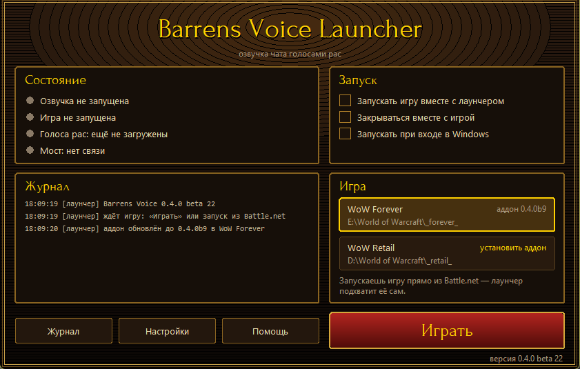
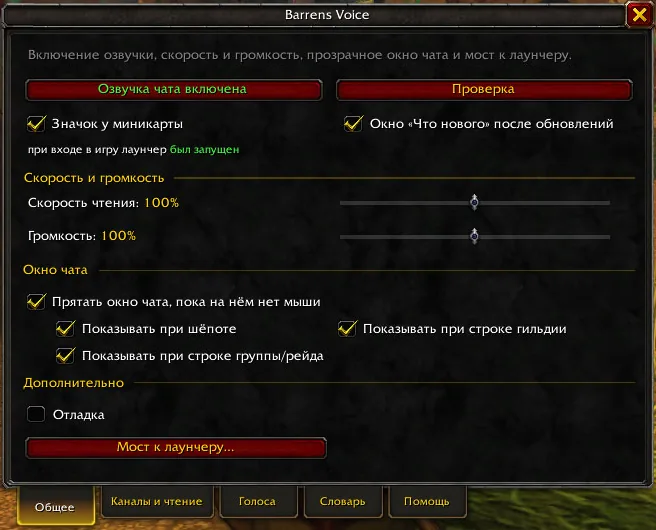
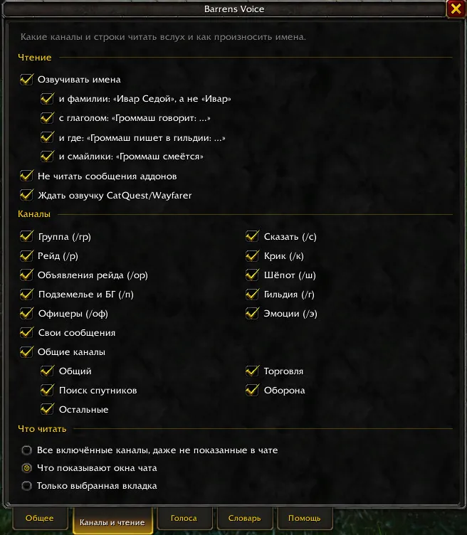
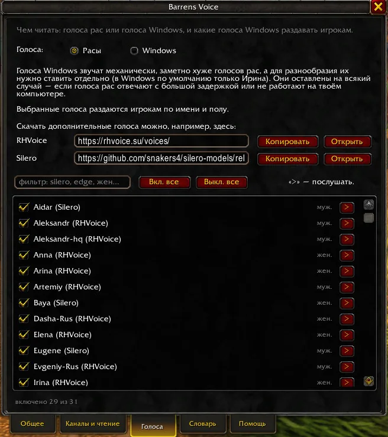
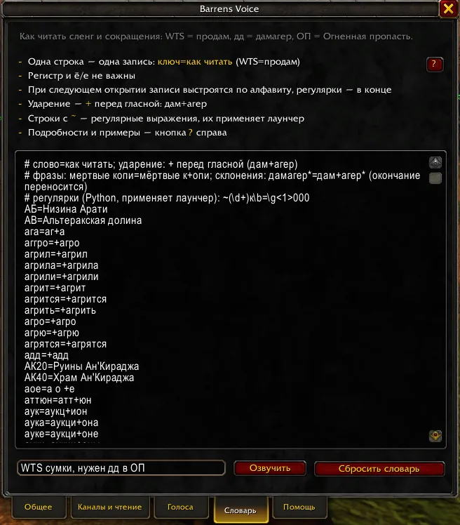

# Barrens Voice

Barrens Voice reads World of Warcraft chat aloud in Russian, each player in a voice matching their character's race and gender.

It needs the Russian game client and Barrens Voice Launcher, a free open-source Windows program ([source code on GitHub](https://github.com/rgeraskin/barrens-voice)) that does the speaking: without it the addon stays silent. Get the launcher from the [latest release](https://github.com/rgeraskin/barrens-voice/releases/latest).

Russian is the only language so far: if you would like it in yours, help is welcome, [open an issue](https://github.com/rgeraskin/barrens-voice/issues).

---
 

*Для тех, у кого левый глаз устал косить в угол чата.*

Озвучивает чат World of Warcraft живыми русскими голосами, и у каждого игрока свой голос: орк звучит как орк, ночная эльфийка — как ночная эльфийка.

⚠️ Аддону нужна программа Barrens Voice Launcher для Windows — она и читает чат вслух. Без неё аддон молчит. Программа бесплатная, с открытым исходным кодом: весь код — [на GitHub](https://github.com/rgeraskin/barrens-voice). Скачай установщик со [страницы последнего выпуска](https://github.com/rgeraskin/barrens-voice/releases/latest) и запусти: он поставит лаунчер, а лаунчер — голоса и сам аддон. Аддон, уже поставленный отсюда, тоже подойдёт.

Голоса берутся из русской озвучки самой игры, а читает их нейросеть. Если хочется попроще, можно выбрать голоса Windows.

ℹ️ Название — в честь «чата Степей» (Barrens chat), самого болтливого чата в истории WoW. Читает, впрочем, не только Степи — хотя там, конечно, работы больше всего.

Сделано для WoW Forever с русским клиентом, работает и в ритейле. Хорошо проверено на **WoW Forever** с видеокартой 👉**NVIDIA**👈. Ритейл проверен мало, а на видеокартах AMD и Intel мод не проверялся совсем. Если ты играешь в ритейл или у тебя видеокарта AMD или Intel — напиши, как работает 🙂

Мод ничего не внедряет в игру: это обычный аддон и программа Barrens Voice Launcher рядом с ним.

## Как это работает

- **Аддон** ловит сообщения чата, узнаёт расу и пол написавшего, переводит сленг («WTS» → «продам», «дд» → «дамагер») и передаёт строку лаунчеру.

- **Barrens Voice Launcher** (дальше — лаунчер) — программа для Windows: читает строку вслух голосом этого игрока. Без него аддон молчит.

Аддоны в WoW не могут на лету ни писать в файлы, ни выходить в сеть, поэтому строки идут к лаунчеру через тонкую тёмную полоску у нижнего края экрана. Это «мост»: если увидишь её — так и задумано.

## Что нужно

- Windows 10 или 11 и WoW Forever (или ритейл) **с русским клиентом**: голоса берутся из его озвучки.

- Видеокарта NVIDIA и 3–4 ГБ свободной оперативной памяти — для голосов рас.

- Около 6 ГБ на диске (около 4 ГБ без NVIDIA) и интернет на время установки.

*Подойдёт и другая видеокарта с DirectX 12, но это не проверено, и игра может подтормаживать ([подробнее](https://github.com/rgeraskin/barrens-voice/blob/master/docs/gpu.md)). Без подходящей видеокарты чат читается голосами Windows.*

## Установка

1. Скачай `BarrensVoice-Setup.exe` со [страницы последнего выпуска](https://github.com/rgeraskin/barrens-voice/releases/latest) и запусти.

   *Windows покажет предупреждение SmartScreen «Windows защитила ваш компьютер»: «Подробнее» → «Выполнить в любом случае».*

2. Установщик скачает всё нужное — около 6 ГБ, несколько минут. Если на системном диске мало места, выбери папку на другом.

3. В конце откроется окно Barrens Voice Launcher. Если в карточке игры написано «установить аддон», нажми — аддон установится в папку игры.

При первом запуске лаунчер несколько минут собирает голоса рас из файлов игры, ход видно в окне. Потом запуск быстрый.

**Обновления** приходят сами — и для лаунчера, и для аддона. Обновлять аддон из менеджера аддонов (CurseForge/Wago) тоже можно, но делать это — не обязательно.

*Новая версия скачивается в фоне и ставится, когда ты закрываешь игру. Можно и сразу — кнопкой «Установить сейчас». Обновление вручную и получение тестовых версий можно включить в настройках лаунчера.*

## Как пользоваться

Запусти Barrens Voice Launcher и играй: озвучка включится, когда запустится игра, и выключится, когда ты её закроешь (голоса рас освобождают видеопамять).

Можно запускать игру и из самого окна лаунчера — кнопкой «Играть». Что делают галочки в окне, подскажет само окно, если навести на них мышь.

В игре:

- **Значок у миникарты**: левая кнопка — настройки, правая — включить или выключить озвучку, колёсико — тише или громче.

- **Команды**: `/bv` — настройки, `/bv on` и `/bv off` — включить и выключить, `/bv stop` — замолчать, `/bv last 5` — повторить последние 5 строк, `/bv test` — проверить голоса, `/bv news` — что нового, `/bv help` — все команды.

- При входе в игру аддон пишет в чат, работает ли озвучка.

- **Что нового**: после обновления Barrens Voice аддон сам расскажет в игре, что изменилось. Снова открыть — `/bv news` или кнопка «Что нового» на вкладке «Помощь». Если окно мешает — можно отключить на вкладке «Общее».

*Новости в игру приносит лаунчер: если игра запущена без него, они появятся после его запуска и `/reload`.*

## Настройки

Настройки аддона открываются значком у миникарты или командой `/bv`.

### Общее

- **Скорость/громкость** — ускоряют бег без маунта и делают громче рёв Ониксии. Шучу, это тоже про озвучку)

- **Прятать окно чата** — раз чат и так звучит, окно чата становится прозрачным, пока на него не наведена мышь. Настройка необязательная, но рекомендую её включить.

Строки, которых не слышно (системные, добыча, выключенные каналы), всегда ненадолго показывают окно. Шёпот, гильдия, группа и рейд звучат, но тоже его показывают — это галочки «Показывать при…», по умолчанию включены. Если такая строка ждала, пока договорит CatQuest или Wayfarer, окно покажется ещё раз, когда она зазвучит.

*Если лаунчер запускается, когда ты уже в игре, чат спрячется после `/reload` — лаунчер об этом напомнит.*

По умолчанию **«Прятать окно чата»** выключено, чтобы чат не пропал неожиданно и можно было сначала посмотреть, что и (как круто!) Barrens Voice читает.

### Каналы и чтение

- **Озвучивать имена** — описание опций говорит само за себя.

- **Не читать сообщения аддонов** — не озвучивать строки, которые за других игроков пишут Questie, DBM, BigWigs и подобные аддоны.

- **Ждать озвучку CatQuest/Wayfarer** — если стоит CatQuest или Wayfarer, чат не перебивает их и ждёт, пока они договорят. Только для Forever.

- **Каналы** — какие чаты читать: группа, рейд, гильдия, шёпот, общие каналы и другие. Шёпот читается и от друзей по Battle.net.

- **Что читать** — по умолчанию только то, что показывают твои окна чата. Можно читать только выбранную вкладку или, наоборот, все включённые каналы, даже не показанные в чате: например, убрать «Торговлю» с экрана, но продолжать слушать её.

### Голоса

Если голоса рас на твоём компьютере звучат плохо или тормозят — можно включить голоса Windows. Однако звучат они механически, а из русских в Windows по умолчанию обычно есть только Ирина.

Для разнообразия можно поставить [RHVoice](https://rhvoice.su/voices/), [Silero](https://github.com/snakers4/silero-models/releases?q=SAPI) или голоса Edge через [NaturalVoiceSAPIAdapter](https://github.com/gexgd0419/NaturalVoiceSAPIAdapter).

### Словарь

Вкладка «Словарь» в настройках аддона учит лаунчер читать сленг и сокращения. Каждая запись — на отдельной строке, большие и маленькие буквы не важны. Строка «Озвучить» внизу даёт сразу послушать.

Например:

- Слово или фраза: `WTS=продам`.

- Слово со всеми окончаниями: `дамагер*=дам+агер*`.

- Ударение — `+` перед гласной: `имба=имб+а`.

- Пустая замена — не читать слово: `лол=`.

- `!` в начале замены — не склонять её после предлога: `скачки=!ск+ачки`, и «после скачки» не станет «после скачек».

Для сложных случаев есть регулярные выражения: строка начинается с `~`, например `~(\d+)\s*к\b=\g<1>000` («5к» → «5000»).

Стандартный словарь обновляется сам, а твои записи остаются как есть. Ссылки на квесты и предметы читаются как названия, числа — словами и в нужной форме («на 1 руку» → «на одну руку»).

## Голоса рас

- У каждой расы и пола несколько голосов: голос персонажа и голоса NPC этой расы, каждый ещё чуть выше и чуть ниже.
- У каждого игрока свой голос и свой темп речи, и он не меняется. Голоса раздаются так, чтобы те, кого ты слышишь одновременно, по возможности звучали по-разному.
- В ритейле расы, которых нет в Forever, тоже говорят своими голосами.
- Голоса лаунчер берёт из файлов установленной игры и после каждого обновления игры собирает заново — за несколько минут. Сами файлы игры он только читает и ничего в них не меняет.

## Ограничения

- **В ритейле в подземельях, рейдах, на боссах, в эпохальных+ и PvP чат не озвучивается**: там игра закрывает чат от аддонов. У Forever таких проблем нет.
- Свёрнутую игру лаунчер не видит, и строки к нему не доходят. А игру под другим окном (Alt+Tab) — видит.
- С гаммой на минимуме лаунчер не различает полоску, и чат не читается.

## Ошибки и идеи

Что-то читается не так, или есть идея? Пиши в [игровое сообщество Barrens Voice](https://launch.battle.net/invite/N9KR2WNHDgW), в [issues](https://github.com/rgeraskin/barrens-voice/issues) или в чаты моих модов в [Discord](https://discord.gg/hxpuTQF2Bb) и [Telegram](https://t.me/+NwReoOS9x7hhYjgy).

Приложи строку из журнала (кнопка «Журнал» в окне лаунчера): в ней видно, что было написано и как прочитано.

Подробнее обо всём — [на GitHub](https://github.com/rgeraskin/barrens-voice), что вошло в каждую версию — на [странице выпусков](https://github.com/rgeraskin/barrens-voice/releases) или в [CHANGELOG](https://github.com/rgeraskin/barrens-voice/blob/master/CHANGELOG.md).

## Планы

Пока что не реализовано, но планируется сделать:

- **Подписанный установщик** — чтобы Windows не ругалась.
- **Голоса рас без видеокарты** — свои лёгкие голоса Piper: без требований к видеокарте и без подтормаживаний.
- **Исправления ударений от игроков** — правишь слово у себя, и (после проверки) оно исправится у всех.
- **WoW Classic** — поддержка классических клиентов. Разве если вдруг попросят.
- Когда-нибудь — установка для всех пользователей компьютера.
- Из области фантастики — сделать мод не только на русском. Маловероятно, т.к. для языковых тонкостей нужен native speaker. Помощь с другими языками приветствуется.

## Сделано с AI

Аддон, лаунчер, тесты, этот текст и даже шутка про Ониксию написаны с помощью ИИ.

Сделано по фану: угарно слушать, как, например, орк с троллем меряются сексуальными взаимоотношениями с родственниками друг друга по материнской линии 😁

⚠️ ИИ-хейтеры, просьба: обязательно отпишитесь там, где узнали про этот мод, что это очередной AI-слоп!

## Лицензия

Код — MIT. Тексты и голоса World of Warcraft принадлежат Blizzard Entertainment: образцы голосов делаются из файлов игры только на твоём компьютере и никуда не уходят.

Модель F5-TTS_RUSSIAN — только для некоммерческого использования (CC BY-NC 4.0), она скачивается при установке.
